# 构造 · 下篇

> 上篇讲"里"——膜、绳、尘、辫、量子、意识。
> 下篇讲"表"——同一套东西在可观测面上留下什么数。
>
> 第一章：材料——死粉尘的编织
> 第二章：流变——时间进场
> 第三章：相变——换一种编法
> 第四章：电磁——断头、尾流与量纲

---

# 下篇 · 第一章：材料——死粉尘的编织

> **位置说明**：上篇十章讲"里"——膜、绳、尘、辫、量子、意识。
> 下篇讲"表"——同一套东西在可观测面上留下什么数。
> 下篇第一章从材料开始，因为材料是"表"里最容易被忽略的一层：它太日常，反而没人问它是怎么编出来的。

---

## 下·1.1 材料不是"东西"，是"织法"

前面十章，材料一直是背景：膜是背景，绳是背景，尘是背景。这一章把背景翻到前面来。

一块钢和一块铝，人们说它们"不是同一种材料"。这句话通常指成分不同。但在《构造》里，成分只是粉尘的密度和种类；真正决定一块材料怎么胀、怎么折光、怎么累坏的，是**这些粉尘怎么编**。

同一个元素，换一种编法，读数全变。碳是石墨，也是金刚石；铁是铁素体，也是奥氏体。它们不是"不同的东西"，是**不同的织法**。

织法有三个可以直接读的数：

- **胀**：温度每升一度，结被震松多少（热膨胀 α）。
- **折**：光穿过时被拓扑阻尼拖慢多少，以及温度改变时这个阻尼怎么变（折射率 n 和 dn/dT）。
- **累**：反复冲刷下，结会不会累积松开（疲劳比 R）。

这一章把这三个数一个一个摆出来，看它们是不是都指向同一件事：**排序轴是织法，不是硬度，也不是强度。**

---

## 下·1.2 胀：热膨胀

先看最日常的一个数。

温度升高，材料会胀。胀多少，用线膨胀系数 α 量：每升 1°C，单位长度伸长多少。

把 13 种材料按 α 排开，从 0.55 到 70（单位 10⁻⁶/°C），差一百多倍：

- 熔融石英 0.55，金刚石 1.0，硅 2.6，蓝宝石 5.3，锗 6.1，ZnSe 7.1，ZnS 7.6
- 水晶石英 10.15，MgF₂ 13.7，CaF₂ 18.85
- KBr 43，NaCl 44
- 水 69，PMMA 70

在《构造》里，这件事不需要新机制。温度是应力波；应力波打进材料，把死粉尘的结震松一点，间距就变大。**α 就是"结有多容易被震松"的读数。**

编织越松，越容易胀——这条在直觉上成立。但它只在**同一种织法内部**成立。跨织法一比，就出问题了：金刚石的 α 是 1.0，只有熔融石英的两倍；可金刚石的硬度是石英的十倍以上。如果"越硬越胀不动"是普遍规律，这两个数该差得更多。

真正的规律在下·1.4 的钢里。先记住这个疑问。

---

## 下·1.3 折：折射率的两项

光穿过材料会变慢。在《构造》里，慢的原因不是"介质里的电磁波被极化"，是**活粉尘穿过死粉尘阵列时被拓扑阻尼拖住**。

现在把温度加进去。温度一变，阻尼有两项在动：

- **位置项**：热膨胀把死粉尘的间距拉开，碰撞变少，n 下降。这一项写出来就是

  > dn/dT = −n₀·α

- **转向项**：热把尘的转向自由度激活。尘转得更活，光穿过时被"转向标签"拖得更久，n 上升。

两项合起来：

> dn/dT = −n₀·α + P

P 就是转向项。

### 对表

拿 13 种材料的实测 dn/dT 和 −nα 比，会看到两群：

- **同号组**（dn/dT < 0）：水晶石英、CaF₂、KBr、NaCl、PMMA、水。它们贴着对角线走，斜率 0.4–1.6。位置项主导。
- **反号组**（dn/dT > 0）：熔融石英、MgF₂、蓝宝石、Si、Ge、ZnSe、ZnS。全部落在 y > 0 的一侧，离对角线很远。转向项主导。

最极端的是硅：书里的公式预测 −8.9，实测 +160。锗更狠：预测 −24，实测 +396。这不是"公式差一点"，是**公式只写了一半**。

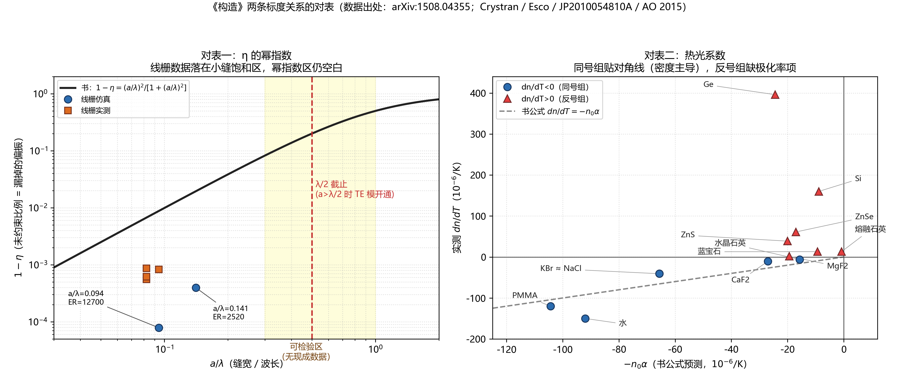

### 零交叉

如果只有位置项，dn/dT 应该在 α = 0 处过零：不胀就不变，一胀就变负。

实测不是。零交叉被推到了 **α ≈ 10–20**（单位 10⁻⁶/°C）：

- α < 8：dn/dT 全正（熔融石英 +12.9、蓝宝石 +13.1、ZnSe +61、Si +160、Ge +396）
- α 10–20：贴着零线（水晶石英 −6.0、MgF₂ +1.7、CaF₂ −10.6）
- α > 40：全负（KBr/NaCl −40.8、水 −150、PMMA −120）

这个偏移就是转向项存在的直接证据。**即使材料在膨胀，只要胀得不够狠，转向项就能赢。**

把位置项扣掉，剩下的残差 P 不是噪声，它按材料分档：

- 普通氧化物/氟化物/卤化物：10–25
- 半导体：59–420（Ge 420、Si 169、ZnSe 78、ZnS 59）
- 聚合物/液体：负（PMMA −16、水 −58）

半导体那一档大一个量级——窄带隙材料的转向自由度最容易被热激活。聚合物/水为负——它们的"转向"不是热激活，是链或氢键网络随温度解体，极化率反而下降。

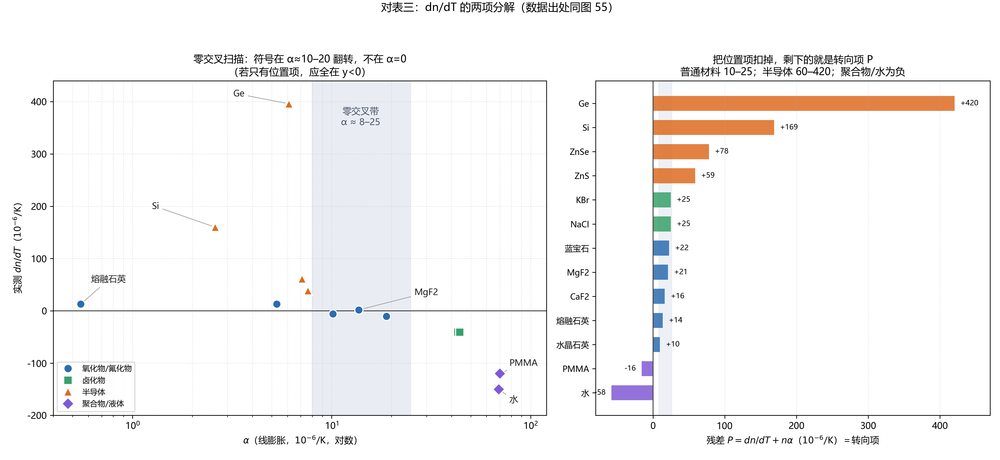

### 转向项的两点位垒（2026-11-03 补）

"转向项"不能只是一个名字。给一个最简单的机制：每个尘的转向住在一个双势阱里。

- 两个取向态 A/B，能量差 Δ，位垒 E_b。
- 布居 f(T) = 1/(1+exp(Δ/k_B T))。
- 两态折射率差 Δn。

于是

> n(T) = n₀ + Δn·f(T)
> P = Δn·(Δ/k_B T²)·f(1−f)

位垒 E_b 不进入平衡态 P，只进入弛豫时间——它是下一章（疲劳）的事。

反推：取 Δ=30 meV、T=300 K，

- P=10 时 Δn≈0.014；P=20 时 0.028
- P=60 时 0.085；P=200 时 0.285；P=420 时 0.598

普通材料 Δn ≈ 0.014–0.028，半导体 0.085–0.6——窄带隙的电子极化率对取向更敏感，差一个量级。这和上面 P 的分档对得上。

温度依赖：200 K 时 P=33，300 K 时 21，600 K 时 6.7（单位 10⁻⁶/K）。高温极限 1/T²，低温极限 exp(−Δ/k_B T)/T²。

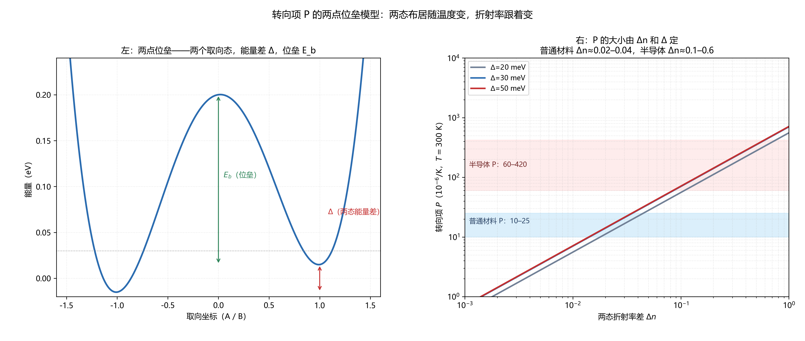

==【问题】两点位垒只给了一个可算的形状，还没给出 Δ 和 Δn 的微观来源。而且从室温一个 P 反推两个参数是欠定的（两个未知、一个方程），需要同一材料不同温度的 dn/dT 才能分开。位垒 E_b 不进入平衡态，只进入循环载荷的速率——疲劳那一节还没接上它。==

---

## 下·1.4 钢：加碳不改织法，换结构才改

钢是最好的试验场，因为人人都知道钢可以"调硬"。

把几种钢按含碳量排开（0–100°C 的 α，单位 10⁻⁶/°C）：

| 钢种 | C（wt%） | α |
|---|---|---|
| 纯铁 | 0 | 12.2 |
| 1010 | 0.10 | 12.2 |
| 1040 | 0.40 | 11.2 |
| 1080 | 0.80 | 12.0 |
| 1095 | 0.95 | 11.4 |
| 430（铁素体不锈钢） | 0.12 | 10.4 |
| 304（奥氏体不锈钢） | 0.08 | 17.2 |
| 316（奥氏体不锈钢） | 0.08 | 15.8 |
| 灰铸铁 | 3.4 | 10.4 |

### 两个数

**第一，加碳几乎不改变 α。** C 从 0 到 0.95%，α 从 12.2 到 11.4，只降 7%，而且不单调——1080 反弹到 12.0。硬化（加碳、淬火）把钢的强度翻了几倍，α 几乎不动。

**第二，换结构改变 65%。** 同为低碳（0.08–0.12%C）：304 奥氏体（FCC）是 17.2，430 铁素体（BCC）是 10.4。

这两条放在一起，结论只能是一个：**α 的排序轴是晶体结构，不是硬度，也不是含碳量。**

加碳是往同一个编织里塞间隙原子，只把晶格撑开一点点；换结构是换一种编织，热膨胀直接跳档。

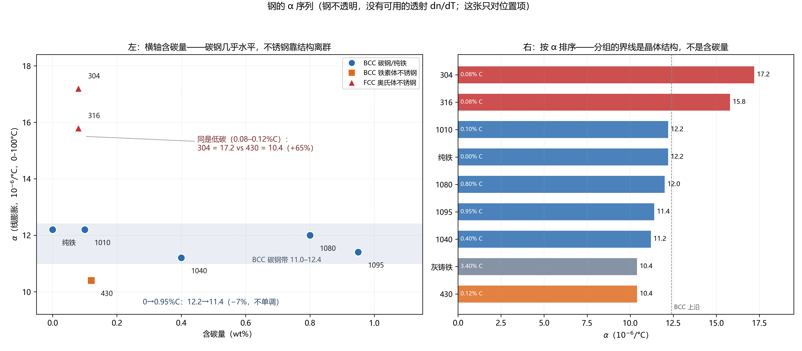

这也解释了下·1.2 留下的疑问：金刚石 α 小，不是因为它硬，是因为它的编织（立方、强共价）本身胀不动。硬度只是同一种织法内部的读数。

---

## 下·1.5 累：疲劳比

材料在反复冲刷下会不会坏，取决于是不是每轮都留下一点残余。

定义疲劳比：

> R = 疲劳极限 / 抗拉强度

在《构造》里，R 有一个直接的意思：**单次冲刷的可逆阈值 / 断裂阈值。**

- 冲刷幅度 < R × 断裂幅度：结每轮回到原位，闭环，永不累积。
- 冲刷幅度 > R × 断裂幅度：每轮留下残余解绑，N 轮之后断，开链累积。

R 就是"闭环"和"开链"的分界。

对表（11 种材料）：

- **BCC 钢**：0.433–0.500，均值 0.471。而且强度越高 R 越低——弹簧钢 1500 MPa 对 0.433，0.4C 正火 540 MPa 对 0.500。
- **FCC 铝**：0.280–0.298，比钢低一档。
- **FCC 奥氏体钢**：0.408——比铝高，比 BCC 钢低。
- **HCP 钛**：0.533，样本里最高。
- **铸铁**：0.400。

分组仍然是结构：BCC/HCP 高（0.43–0.53），FCC 低（0.28–0.41）。强度不是排序轴——弹簧钢强度是铝的三倍，R 反而更高。

**铝没有真正的疲劳极限，在书里就是这个意思**：它的 R 低到几乎没有门槛，结在很低的应力下就开始累积解绑，S-N 曲线压不出水平线。BCC 钢的结有明确的"回位"阈值，所以能压出水平线。

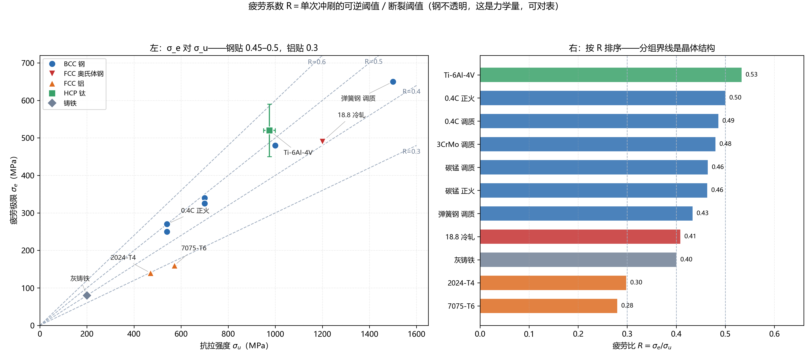

---

## 下·1.6 金刚石：晶向是伪问题

有人会问：金刚石不同晶向的热光系数一样吗？

先看对称性。金刚石是立方晶系。热膨胀和折射率都是二阶张量，立方对称下只有一个独立分量。所以**无应力时，不同晶向的 α、n、dn/dT 完全一样**。

这不是数据不够，是物理禁止它们不一样。

要有晶向差异，必须先有一个打破对称性的东西。最常见的是**约束**：金刚石薄膜粘在基底上，想胀胀不开，热应力出来了，压光效应把折射率劈成两个方向。

按 (001) 面完全双轴约束算一笔：

- 无应力时 dn/dT 都是 9.6（单位 10⁻⁶/K）
- 约束后：面内 **7.9**，面外 **11.4**
- 双折射 **3.5×10⁻⁶/K**

(111) 面的量级更小，约是 (001) 的三分之一。

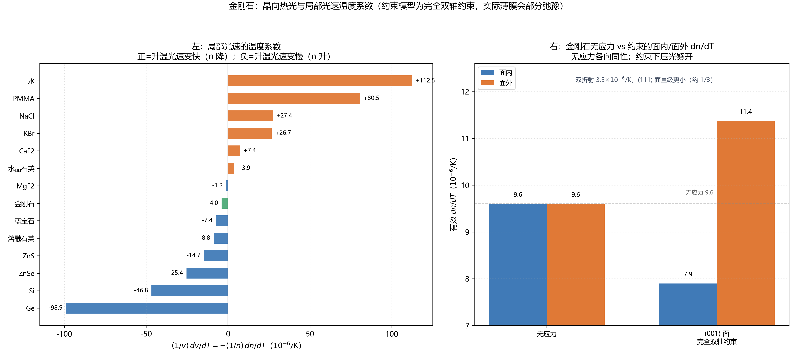

教训不是"金刚石有晶向差异"，是：**问"不同晶向"之前，先问"有没有打破对称性的东西"。** 没有约束，晶向是伪问题；有了约束，晶向才变成真问题。

---

## 下·1.7 光速：从比值到可检验约束

这一章最后一节，把材料数据推回宇宙设定。

第八章说过，膜面波速是

> c = √(T/ρ)

T 是张力，ρ 是面密度。这个式子的绝对值测不到——我们不知道 T 和 ρ 各自是多少，只知道它们的比值锁定在 c²。

但材料里的光速是 v = c/n。n 是拓扑阻尼。把这个式子对温度求导，得到

> (1/v)·dv/dT = −(1/n)·dn/dT

这个量只依赖 n 和 dn/dT，不碰 T/ρ 的绝对值。

对表：

- 水 +112.5，PMMA +80.5，NaCl +27.4，KBr +26.7，CaF₂ +7.4，水晶石英 +3.9
- MgF₂ −1.2，**金刚石 −4.0**，蓝宝石 −7.4，熔融石英 −8.8，ZnS −14.7，ZnSe −25.4，Si −46.8，Ge −98.9

（单位 10⁻⁶/K。正 = 升温光速变快，负 = 升温光速变慢。）

正负分组和 dn/dT 完全一致：位置项主导的材料（水、聚合物、卤化物）升温光速变快（n 降）；转向项主导的（半导体、氧化物）升温光速变慢（n 升）。

### 这一节的意义

如果 T/ρ 恒定，那么**局部光速的温度变化全部来自 n**。

- 书里不用测 T 和 ρ，就能预言"光速随温度怎么变"。
- 反过来，这是一条可检验的约束：任何材料的 (1/v)dv/dT 必须等于 −(1/n)dn/dT。如果发现偏差——出现一个与 n 无关的项——就说明 T/ρ 不是常数。

这把"固定比值"从"测不到的设定"变成了"可检验的约束"。

全书大部分地方是"图像自洽，等实验"；这一条不一样，它给了一个**现在就能对表**的判据。

==【问题】要真正检验这条，需要同时测准 n、dn/dT 和 dv/dT 三个量。目前没有一组材料把三个量都测齐到能分辨偏差的精度。这一格是"可检验"，不是"已验证"。==

---

## 下·1.8 一个刚度够不够

前面三节——胀、折、累——各给了一个读数。很自然会问：它们是不是同一个东西的三种读法？如果材料的"织法"能压缩成一个数（刚度），那三个读数应该都随这个数走。

拿体模量 K 试。它是最直接的"结绷得多紧"。

结果是否定的：

- **α 与 K 弱负相关**：斜率 −0.71，r = −0.71。趋势有，散点宽。
- **P 与 K 无关**：r = 0.30。Si 和 Ge 的 K 只有 98 和 75 GPa，P 却是 169 和 420——全场最大。
- **R 与 K 无关**：Fe、Al、Ti 的 K 是 170、76、110 GPa，R 却是 0.47、0.29、0.53，不单调，差 1.8 倍。

最刺眼的一对在胀的图里：**熔融石英（K=37，α=0.55）和水晶石英（K=38，α=10.15）**。同样的成分、几乎同样的刚度，非晶和晶体的热膨胀差 18 倍。K 看不见"非晶"和"晶体"这个差别——它只看得见"结有多紧"，看不见"结怎么编"。

所以，**编织不是一个标量**。三个读数听三个不同的东西：

- 位置项（α）听**晶格刚度**。
- 转向项（P）听**电子自由度**（带隙）。
- 可逆性（R）听**滑移系和结构**。

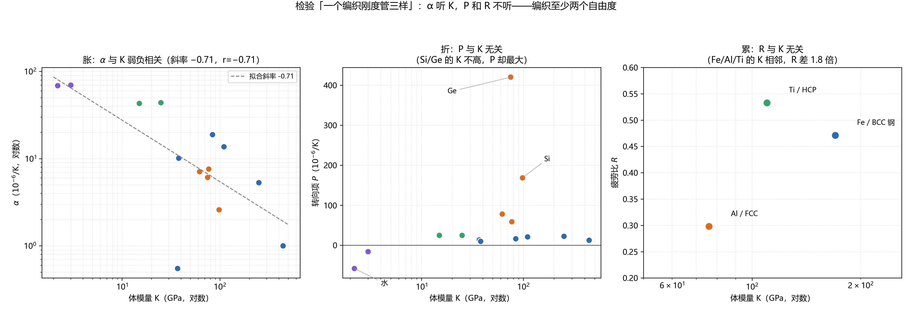

这不是坏消息。它反过来把 1.3 的两项分解焊死了：如果 P 也听 K，那两项分解就是多余的——一个参数就够了；P 不听 K，它才是一个独立的自由度。

方法论上也有一句：**下篇要找的不是"一个材料参数"，是"每个读数听谁"。** 找单一参数会失败，分对层才成立。

---

## 下·1.9 辫群接不接得上

1.8 的结论是"编织不是一个标量"。那它是不是辫群？如果堆垛周期就是辫的股数，材料参数应该能从辫群推出来。

试了。老老实实记下来，包括失败的部分。

假设：AB 两层 → B2，ABC 三层 → B3。HCP 和 BCC 是 AB，FCC 是 ABC。

**第一轮，四个点。** 取 σ_a = 0.5σ_u 时的每轮解绑率 p：B2 组内差 58 倍（钛 → 钢），B3 组内差 7 倍（304 → 铝）。看起来 B3 被拓扑锁住，B2 散开。

**第二轮，扩样本。** 加到 B2 十个、B3 九个。结论翻了：B3 的 R 范围 2.3 倍，B2 只有 1.6 倍；p 更夸张，B3 横跨五个数量级。**B3 反而更散。**

**第三轮，分层。** 把混在一起的材料拆开，按族 → 结构 → 状态算：

- 结构（铁基内 BCC vs FCC 退火）：0.476 vs 0.368 → 1.29 倍
- 材料族（FCC 内铝 vs 镍退火）：0.297 vs 0.548 → 1.8 倍
- 状态（镍退火 vs 冷拔）：0.548 vs 0.379 → 1.45 倍

**材料族 ≈ 状态 > 结构。**

所以老实说：这条线现在接不上。不是辫群错了，是数据不是为这个问题收集的——同族、同状态、只换结构的干净对照，只有铁基一组，而它的 FCC 退火只有一个点。方向上 BCC 高于 FCC，支持"B2 可逆性高"，但一个点撑不起一句话。

结构效应是三层里最弱的，信号被前两层盖住。要接，得先控住材料和状态，再换结构。

这条留在断点里，不硬圆。

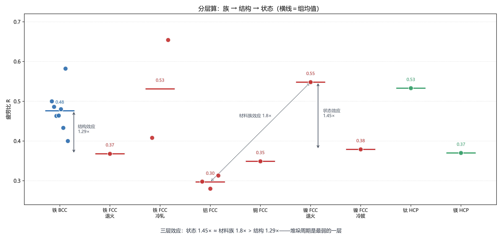

---

## 下·1.10 本章的账

这一章把"材料"从背景翻到前面，得到的不是新机制，是三个读数：

- **胀**：α 的排序轴是晶体结构，不是硬度。
- **折**：dn/dT = −nα + P，P 是转向项，按材料分档。
- **累**：R = 单次冲刷的可逆阈值/断裂阈值，分组还是结构。

三个读数指向同一句话：

> **材料的性质，是编织的读数，不是成分的读数。**

这句话在《构造》里不是比喻。膜、绳、尘、辫，前面十章讲的是"里"；这一章讲的是同一套东西在"表"上留下的数。数是硬的，解释还是软的——这是本章和前十章一样的处境。

---

## 下·1.11 【待连接的断点】

- **转向项的微观机制**：尘的哪个自由度在转？势垒多高？为什么窄带隙材料转得更容易？现在只有名字。
- **钢的 α 数据在 1080 反弹**：12.0 高过 1040 的 11.2，在来源/状态差异之内，但没有排除真实效应。需要同一批次、同一状态的测量。
- **疲劳 R 的层错能排序**：同一 FCC 结构内，R 是否随层错能排序（铝高堆垛层错能 → 交叉滑移容易 → R 低；奥氏体钢低层错能 → 平面滑移 → R 高）？这条可以用现成数据排一次序。
- **金刚石 (111) 面**：本章只算了 (001) 的完整形式；(111) 需要完整的张量变换，数值会小一些，没有算到底。
- **光速约束的精度**：需要一组材料同时把 n、dn/dT、dv/dT 测齐。现在没有。
- **η 的幂指数**：第九章的 η = 1/(1+(a/λ)²) 在大缝极限给出 (λ/a)²，但现有线栅数据全落在小缝饱和区，可检验区（a/λ 0.3–1）没有现成数据。真实系统在 λ/2 处是截止断崖，不是平滑幂律。**这条要打，得自己做变缝宽单缝偏振实验。**
- **辫群到材料的桥**：堆垛周期 → B_n 的假设，目前被材料族（1.8×）和状态（1.45×）两层盖住，结构效应只有 1.29×。需要同族、同状态、只换结构的对照；铁基 BCC vs FCC 退火有方向（0.476 vs 0.368），但 FCC 退火只有一个点。**在拿到干净对照之前，这条不写进结论。**

---

# 下篇 · 第二章：流变——时间进场

> **位置说明**：第一章讲材料"是什么"——胀、折、累三个读数。
> 这一章讲材料"什么时候变"——同一个东西，你等得快和等得慢，答案不一样。

---

## 下·2.1 同一个东西，两个答案

有一块沥青。

你用锤子敲它，它碎——是固体。
你把它放在斜坡上，过一夜，它流下去了——是液体。

它没有变。变的是你等多快。

流变学就是这件事：**材料的响应，取决于观察的时间尺度。** 一根绳子，你拉一下就松手，它弹回去；你拉住不放，它慢慢松；你拉得很快，它可能直接断。三种答案，同一根绳子。

第一章的三个读数——胀、折、累——都是在"给定温度、给定应力"下测的。它们默认了一件事：**你等的时间足够长，或者足够短，长到短到不影响答案。**

流变学说：这个默认不总成立。时间也是一个变量。

---

## 下·2.2 弹簧与黏壶

流变学把材料拆成两个理想元件。

**弹簧**：拉它就伸，松手就回。能量存进去，还能拿出来。响应是瞬时的、可逆的。

**黏壶**：推它就流，松手不回来。能量变成热，拿不回来。响应是时间的、不可逆的。

在《构造》里，这两个元件是两种编织状态：

- **弹簧**：结被拉开，但还在原位，松手能弹回去——**闭环**。
- **黏壶**：结滑开了，换了一个位置，回不去——**开链**。

任何一个真实材料都是两者的混合。差别只在比例，和"你等多快"。

---

## 下·2.3 蠕变：恒应力下慢慢松开

给材料一个恒定的力，不动它，只看应变怎么长。

三段：

1. **初级**：应变长得快，但越来越慢。能重新编回去的结先松，松到一定程度就停。
2. **稳态**：应变匀速增长。松开的速率和重新编上的速率打平。
3. **加速**：应变越来越快，直到断。重编跟不上了，结一批批地开链。

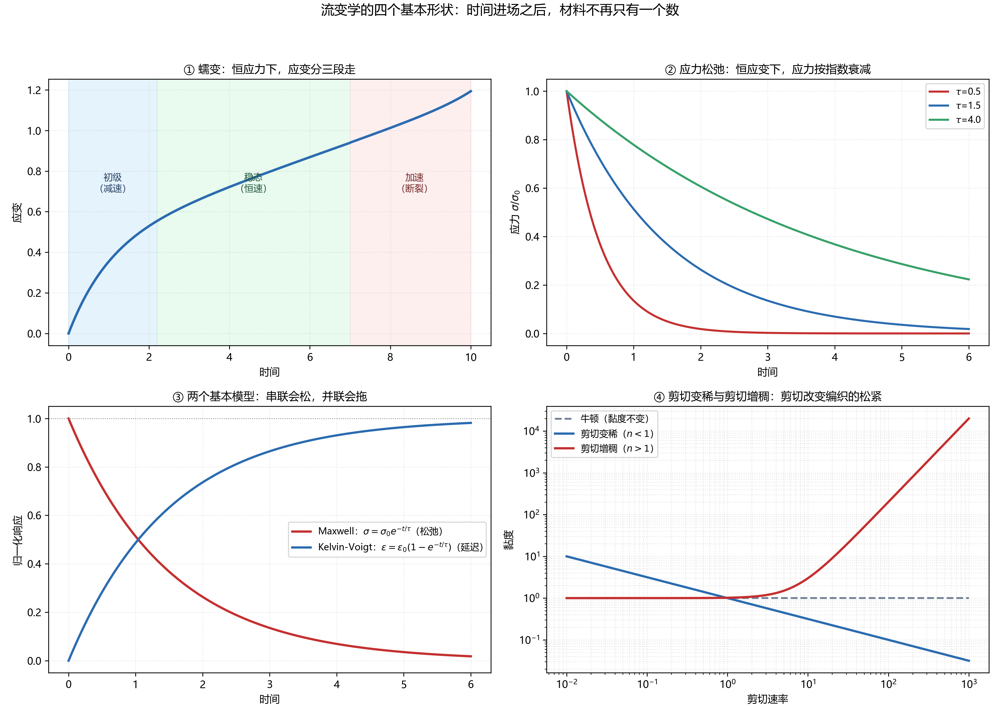

在《构造》里，这三段是一条很直的话：**应力波持续注入，结一个个松开；松开的速率超过重编的速率，就走向断裂。**

稳态那一段最有意思：它不是"平衡"，是"两个速率相等"。材料看起来不动，其实一直在松开和重编，只是账面上打平。

### 一个跨材料的数：Q ≈ 18 R T_m

稳态蠕变的速率方程：

> dε/dt = A·σⁿ·exp(−Q/RT)

Q 是蠕变活化能，n 是应力指数。

拿八种材料对表，Q/(R T_m) 集中在 17–23：

| 材料 | T_m（K） | Q（kJ/mol） | n | Q/(R T_m) |
|---|---|---|---|---|
| Al | 933 | 142 | 4.4 | 18.3 |
| Cu | 1358 | 203 | 4.8 | 18.0 |
| Au | 1337 | 201 | 5.5 | 18.1 |
| Ni | 1728 | 278 | 4.6 | 19.4 |
| α-Fe | 1811 | 260 | 6.9 | 17.3 |
| 316 SS | 1700 | 280 | 5.5 | 19.8 |
| Inconel 718 | 1600 | 300 | 5.0 | 22.6 |
| Ti | 1941 | 150 | 4.5 | **9.3** |

Q 是"结松开的能量"，T_m 是"整根绳断掉的能量"。两者成比例，说明**松开和断是同一个能量尺度的两个刻度**：熔点高的材料，松开也难，按同一比例难。

Ti 离群（9.3）：它的蠕变机制不同，不能用同一把尺子。

n 都在 4.4–6.9，结构差异被机制盖住——和第一章"材料族 > 结构"是同一个教训。

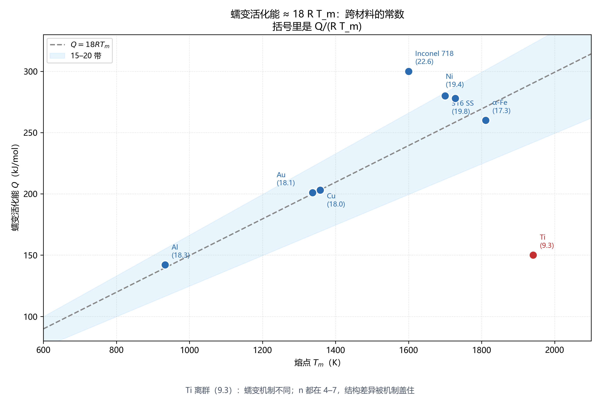

---

## 下·2.4 应力松弛：恒应变下的衰减

反过来：把材料拉住，不让它动，看应力怎么降。

应力按指数衰减，时间常数 τ：

> σ(t) = σ₀·e^(−t/τ)

在《构造》里，这不是"力消失了"，是"力被重新分配了"。结在固定不变的形状里重新排列，把局部的应力摊平。摊平之后，外面测到的力就小了。

τ 的长短是编织的读数：

- τ 长：编得紧，松得慢，像固体。
- τ 短：编得松，松得快，像液体。

同一个材料，温度不同，τ 也不同——这是 2.8 的事。

---

## 下·2.5 串联会松，并联会拖

两个最基本的黏弹性模型：

- **Maxwell（串联）**：弹簧和黏壶串在一起。恒应变下，弹簧先撑住，黏壶慢慢滑，应力衰减。
- **Kelvin-Voigt（并联）**：弹簧和黏壶并在一起。恒应力下，弹簧想立刻伸，黏壶拖住它，应变延迟。

在《构造》里：

- **串联 = 两条路竞争**。应力波可以走弹簧（立刻），也可以走黏壶（慢慢），哪条快走走哪条。所以松弛。
- **并联 = 两条路必须一起走**。弹簧要伸，黏壶必须跟着让；黏壶要流，弹簧必须跟着拉。所以延迟。

这两个模型不是"两种材料"，是"两种编织方式"：串联是并联的结和串联的结，并联是互相锁住的结。

---

## 下·2.6 剪切变稀与剪切增稠

有些材料，你搅得越快，它越稀；有些材料，你搅得越快，它越稠。

- **剪切变稀**：油漆、血液、聚合物熔体。搅动让编织对齐，流动更容易。
- **剪切增稠**：玉米淀粉糊、湿沙。搅动把结挤紧，流动更难。

在《构造》里，这不是"黏度"这个数变了，是**编织的构型变了**。剪切是一种定向的应力波，它把结往某个方向推：

- 推得整齐，路就通——变稀。
- 推得挤在一起，路就堵——变稠。

同一锅玉米淀粉，慢慢搅是液体，猛一捶是固体。不是它有两个黏度，是它有两种构型。

### n 的数据

幂律方程 η = K·(剪切速率)^(n−1)，n 是判据：n<1 变稀，n=1 牛顿，n>1 变稠。

对表：

| 材料 | n |
|---|---|
| PVC | 0.20–0.50 |
| PE | 0.30–0.60 |
| HDPE | 0.50 |
| iPP | 0.36–0.43 |
| Nylon | 0.60–0.90 |
| 血液 | 0.70–0.90 |
| 涂料 | 0.50–0.80 |

全部在 n<1 一侧。

在《构造》里，n 是"编织被剪切对齐的程度"：n 越小，对齐越快，越稀。Nylon 和血液接近 1，说明它们的编织不容易被剪切改变——链短，或者结构本身刚性。

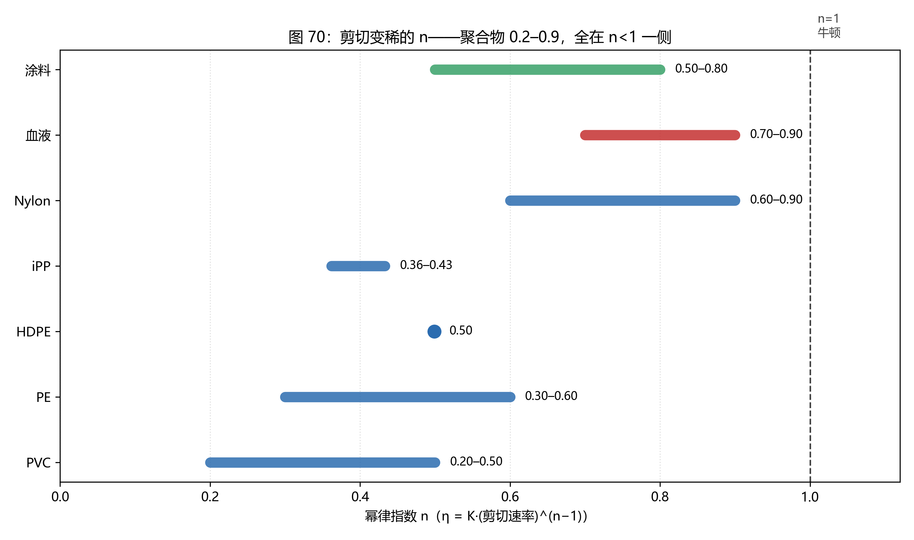

---

## 下·2.7 屈服应力：从固体到液体的门槛

牙膏、蛋黄酱、混凝土：不加力，它不动；加够了力，它流。

这个门槛叫屈服应力。

在《构造》里，屈服是最直接的"闭环/开链"判据：

- 力在门槛以下：结被拉开，但还能回原位——**闭环**，表现为固体。
- 力在门槛以上：结滑开，回不去——**开链**，表现为液体。

门槛本身不是"强度"，是"结的静摩擦"。它和第一章的疲劳比 R 是同一类量：**都是"可逆/不可逆"的分界**。R 管循环，屈服管持续。

### 屈服应力跨十一个数量级

| 材料 | 屈服应力 |
|---|---|
| 血液 | 0.005 Pa |
| 番茄酱 | 20 Pa |
| 泥浆 | 50 Pa |
| 牙膏 | 80 Pa |
| 蛋黄酱 | 150 Pa |
| 新拌混凝土 | 1000 Pa |
| 铝（屈服强度） | 200 MPa |
| 钢（屈服强度） | 500 MPa |

从血液到钢，差 **11 个数量级**。

两个数来自不同测试：血液是**剪切屈服**（低剪切速率下的流动曲线），钢是**拉伸屈服强度**（单轴拉伸）。只比量级，不比值。钢的剪切屈服约为拉伸的 0.5–0.6（von Mises），换过来仍是 10¹¹ 量级。

这是全书里跨度最大的一个数：α 差 100 倍，Q 差 2 倍，屈服应力差 10¹¹ 倍。

在《构造》里，这说明"结的静摩擦"可以横跨几乎整个可观测范围——从几个分子缠在一起（血液），到整块晶格锁死（钢）。同一个机制，尺度拉到极限。

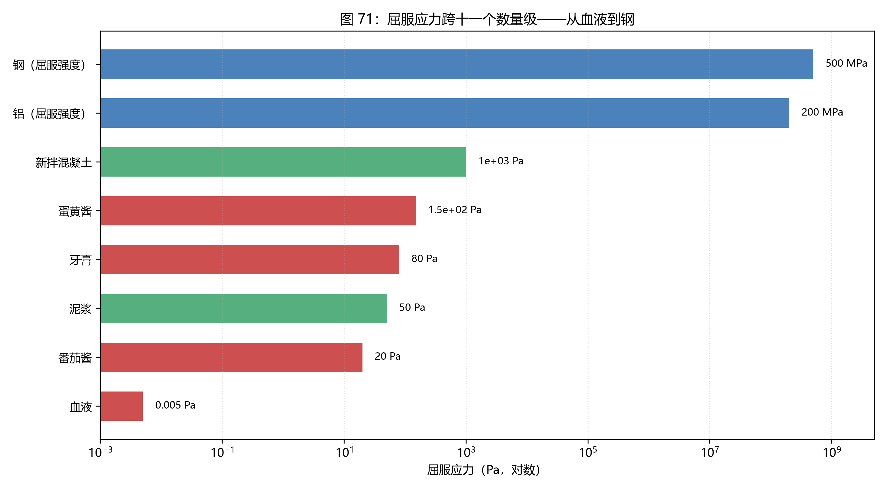

---

## 下·2.8 时温等效：温度和时间可以互换

流变学有一个经验规律：**升高温度，等于把时间调快。**

高温下材料松弛得快，像你等了很久；低温下松弛得慢，像你只等了一瞬。这就是时温等效（WLF 方程）。

在《构造》里，这一条和第一章的转向项是同一件事的两面：

- 温度是应力波的强度。
- 温度升高，结的弛豫速率变快——和 1.3 里"热把转向自由度激活"是同一个机制。
- 所以"高温 = 快时间"不是巧合，是**温度在改编织的速率**。

这一条把流变学和热学接上了：**热不只是让材料胀，还让它松得快。**

WLF 方程：log(a_T) = −C₁(T−T_ref)/(C₂+T−T_ref)。

多数聚合物在 T_ref = T_g 附近取 C₁≈17.4、C₂≈51.6 K——另一个跨材料的常数，和 Q≈18RT_m 同类。不同聚合物共用这两个数，说明**"温度怎么改速率"这件事，比"材料是什么"更普适。**

---

## 下·2.9 本章的账

第一章给了三个读数：胀、折、累。这一章加了第四个：**时间**。

- 胀、折、累：给定温度/应力下的数。
- 流变：给定时间尺度下的数。

一句话：

> **材料不只有一个数，还有一个时间常数。**

弹簧和黏壶、串联和并联、变稀和变稠、屈服和流动——都是这一句话的不同写法。

---

## 下·2.10 【待连接的断点】

- **蠕变的微观速率**：结松开和重编的速率怎么定？现在只有三段形状，没有速率方程。
- **屈服应力的拓扑判据**：门槛对应辫群的什么？是 B2 的"全或无"，还是 B3 的"多路径"？
- **时温等效的拓扑解释**：为什么高温等于快时间？现在只说是"同一机制"，没有算出指数。
- **和第一章的疲劳接不上**：疲劳是循环，流变是持续；两者的"残余"是不是同一个量？如果是，R 和屈服应力应该能互相换算。
- **剪切增稠的边界**：玉米淀粉的"一捶就硬"有没有一个临界剪切速率？现在只有定性。

---

# 下篇 · 第三章：相变——换一种编法

> **位置说明**：第一章讲材料是什么，第二章讲材料什么时候变。
> 这一章讲材料**换一种编法**的时候——冰、水、汽、超导，同一批尘，不同的编法。

---

## 下·3.1 相不是"东西"，是"编法"

冰、水、水蒸气，都是 H₂O。

三者的区别不在成分，在编法：冰是氢键网络锁死的有序排列，水是网络断开、分子还能滑动，汽是网络彻底散开、分子各自飞。

超导也一样。同一批电子，平时各自散射，低温下两两配对，形成一个新的宏观编法。成分没变，编法变了。

所以"相"不是"什么东西"，是"怎么编"。相变就是换编法。

换编法有两种换法：一种要付钱（一级），一种不用付钱（二级）。

---

## 下·3.2 一级相变：换编法要付钱

冰化成水，要吸热：334 kJ/kg。
水变成汽，要吸热：2260 kJ/kg。

这些热叫潜热。它的意思是：**换编法要先把旧结拆开，拆结要付能量。**

拆开之后，新编法不一定马上接上。所以在熔点附近，冰和水可以共存——一块冰放在水里，界面以内是冰的编法，界面以外是水的编法。界面就是"没换完的地方"。

在《构造》里，一级相变就是**局部换编法**：

- 旧结拆开要吸热（潜热）。
- 新结编上要放热（凝固热）。
- 两相共存 = 换到一半，界面两边各编各的。

---

## 下·3.3 冰：有序的代价

水结冰，分子从无序到有序，氢键网络锁定。

有序通常意味着更紧密，但冰反而更轻：密度 0.917，水是 1.0。

为什么？因为冰的氢键网络是**撑开的**：每个水分子和四个邻居形成四面体，中间留出空腔。有序不是挤紧，是**撑成一个架子**。

在《构造》里，这是一个反直觉但重要的例子：

> **有序 ≠ 紧密。** 编得整齐，可能占更大的地方。

冰的编织是"撑着"的，水的编织是"挤着"的。结冰时，水把架子撑起来，体积变大——所以冰浮在水上，所以水管会冻裂。

---

## 下·3.4 汽水：压力撑着的亚稳

CO₂ 能溶在水里，靠的是压力。

亨利定律：溶解度正比于分压。

> c = k_H · P

25°C 时 k_H ≈ 0.034 mol/(L·atm)。汽水灌装时 CO₂ 分压约 3 atm，溶解度约 0.10 mol/L；开瓶后分压降到 1 atm，溶解度降到 0.03 mol/L——多出来的 0.07 mol/L 必须跑掉。

在《构造》里，气体是被**压**在液体编织的缝里的。外部压力一撤，缝撑不住，气就跑出来。

汽水不是平衡相变，是**亚稳**：开瓶前它是过饱和的，靠瓶盖撑着；开盖的一瞬间，亚稳塌了。

摇晃、加薄荷糖，都是给气一个**成核点**——让气泡有地方长。没有核，过饱和可以撑很久（微波炉加热水突然暴沸，也是这个道理）。

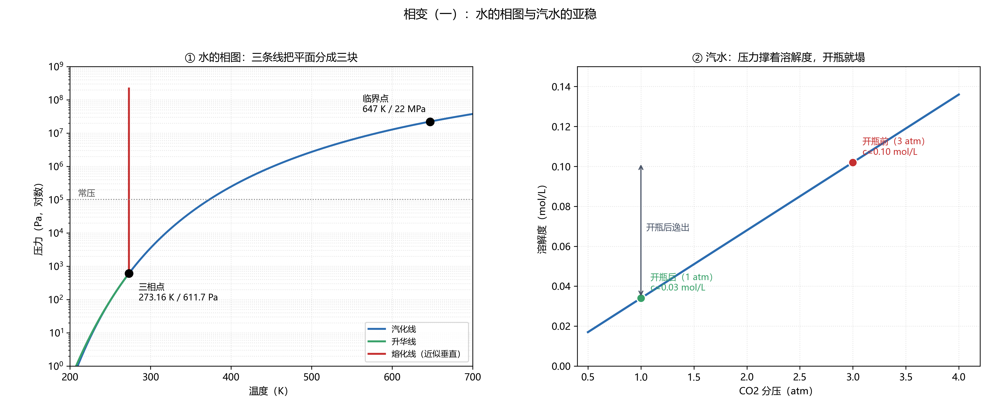

---

## 下·3.5 二级相变：序参量自己长出来

超导不是"换一种东西"，是"长出一个新的序"。

温度降到临界温度以下，电子两两配对（库珀对），形成一个宏观量子态。这个过程没有潜热，比热只有一个跃变。

一级和二级的区别，用序参量看最清楚：

- **一级**：序参量在转变点**跳变**——从 1 掉到 0，中间没有过渡。
- **二级**：序参量**连续**地从零长出来——越靠近转变点越小，转变点上刚好为零。

在《构造》里：

- 一级是"换编法"——旧结拆开，新结编上，中间有界面。
- 二级是"编法自己长出来"——没有界面，序参量从零连续长到一。

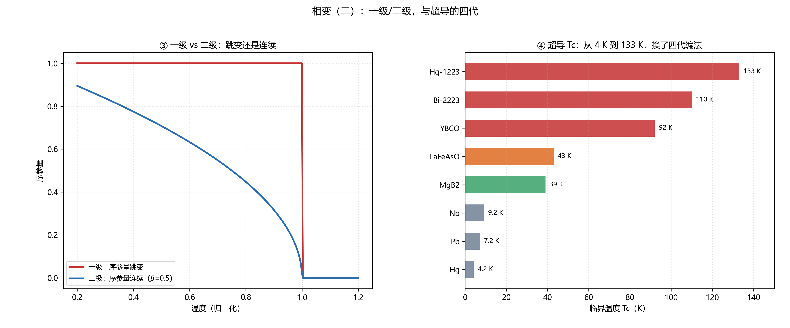

---

## 下·3.6 超导：编织的拓扑屏蔽

超导有两个标志：零电阻，和迈斯纳效应。

零电阻好理解：电子配对之后，不再被晶格散射，电流可以一直流。

迈斯纳效应才是要害：**磁场被排斥在外**。不是"磁场进不去然后衰减"，是完全排斥——超导体内部磁场为零。

在《构造》里，这就是第四章的**拓扑法拉第笼**。

新编法（库珀对凝聚态）对外部应力波（磁场）形成一个拓扑屏蔽：磁场想进去，但编法不允许。这不是"抗磁"，是"结构上不兼容"。

临界温度、临界磁场，就是屏蔽被打破的阈值：外部应力波强到一定程度，新编法被打散，超导消失。

四代超导，Tc 从 4 K 到 133 K：

- 元素：Hg 4.2 K、Pb 7.2 K、Nb 9.2 K
- 合金：MgB₂ 39 K
- 铁基：LaFeAsO 43 K
- 铜氧化物：YBCO 92 K、Bi-2223 110 K、Hg-1223 133 K

每一代都是"换一种编法"，把屏蔽撑到更高的温度（图 73④）。

### 拓扑超导：辫群真的能算

前面说"编织"一直是图像。拓扑超导里，它变成了算式。

拓扑超导的边界上有 Majorana 零模。这些准粒子互相换位置时，不是简单交换，而是**编辫子**——交换两次不回原样，换的顺序不同结果也不同。这个"编辫"的规则，就是辫群 B_n。

拿 4 个 Majorana 算（= 2 个费米子，4 维空间）：

> σ_i = exp(π/4 · γ_i γ_{i+1}) = (I + γ_i γ_{i+1})/√2

数值验证三件事：

1. **辫关系精确成立**：σ₁σ₂σ₁ = σ₂σ₁σ₂，误差 0。
2. **非阿贝尔**：σ₁σ₂ ≠ σ₂σ₁，矩阵元的模一样，相位差 90°。
3. **交换两次不回原样**：σ₁² ≠ I。

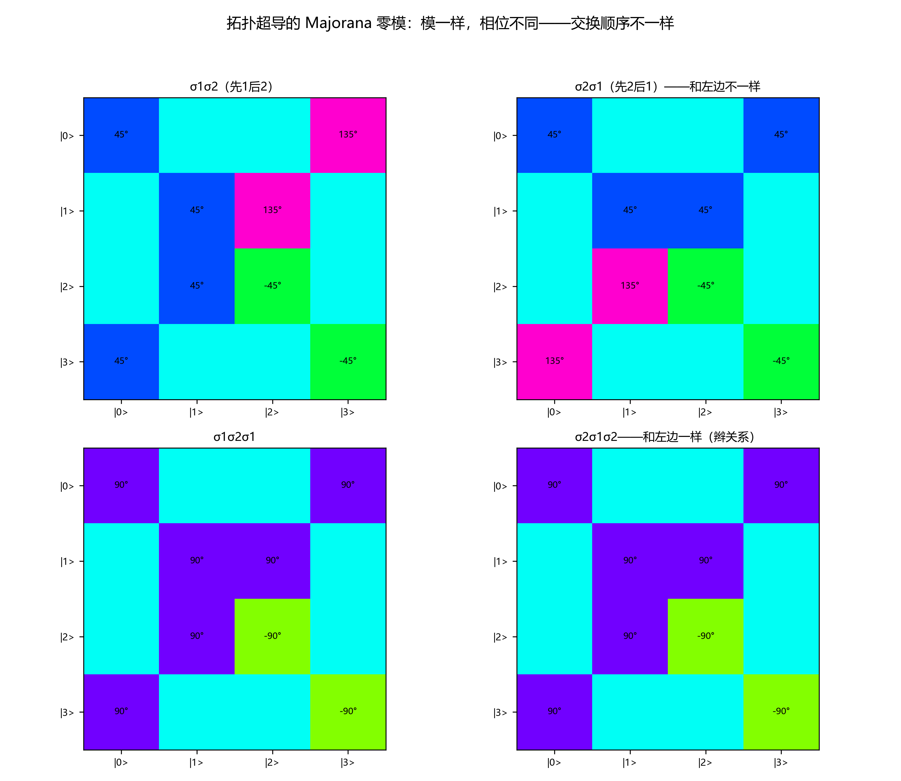

这是书里的辫群（B2/B3）第一次在真实物理系统里有**严格对应**，不是类比。绳子的"解开"和准粒子的"换位"，用的是同一个群。

==【问题】同构成立，但物理不同：书里的绳是连续的、四维的；Majorana 是准粒子、三维的。数学同构能不能推出物理结论，还要看"辫群的元素"在两边的物理含义是否一致——现在没有这个映射。==

### 奇偶开关：辫不改变宇称

拓扑超导比普通超导多一个开关：**费米子宇称**。这个态是偶数个电子还是奇数个电子，是拓扑保护的，局部扰动改不了。

4 个 Majorana（= 2 个费米子）为例，宇称算符 P = γ₁γ₂γ₃γ₄，本征值 ±1 各 2 维。

数值验证三件事：

1. **P² = I**，本征值 +1 两个、−1 两个。
2. **辫操作不改变宇称**：[σ₁, P] = [σ₂, P] = 0，误差 0。
3. **在 P 的本征基下，σ₁σ₂ 是块对角的**：偶扇区 2×2、奇扇区 2×2，两边不混合。

用大白话：

> 奇偶开关决定你在哪个房间编辫；辫怎么编，都不改房间。

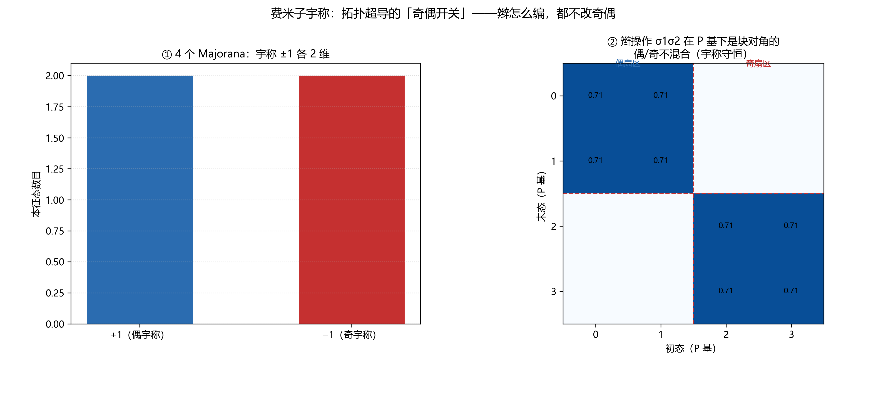

==【问题】"缠绕数 m 的奇偶当开关"这个说法要改：m 是单个涡旋的相位绕数，宇称是 Majorana 零模的费米子数奇偶。两者有关系（涡旋数目的奇偶 → 零模数目的奇偶），但不是同一个量。书里按"费米子宇称"写，不按"m 的奇偶"写。==

### ZBCP：能算，但不能单凭它断定

STM 测 Majorana，最常见的信号是零能电导峰（ZBCP）。这个峰能算——用一维 Kitaev 链：

- 拓扑相（|μ| < 2t）：两端各一个 Majorana 零模，端点零能态密度是一个平台（≈1.05）。
- 非拓扑相（|μ| > 2t）：零能态密度 ≈ 0。
- 边界 μ = ±2t：跳变。

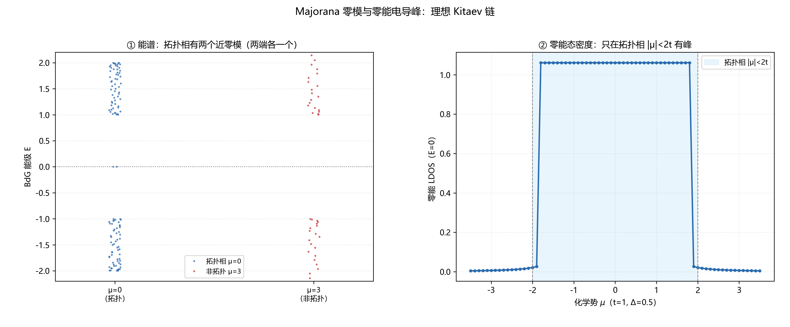

但真实的 ZBCP 有很多假阳性来源：

- Andreev 束缚态（ABS）在零能也能给峰。
- 无序、磁性杂质、Kondo 效应。
- 所以 ZBCP 是**必要不充分**证据——看到峰，不等于看到 Majorana。

真正能定断的判据是三条：

1. 峰高量子化（理想 2e²/h）。
2. 只在拓扑相出现（扫化学势/磁场，峰出现和消失的位置对得上）。
3. 空间分布：两端局域，中间没有。

用书里的话：**ZBCP 是"表"的信号，宇称和拓扑是"里"的判据。** 只看峰，会被假阳性骗；三条一起看，才是判据。

### 无序：压能隙，还造假日零能

在 Kitaev 链上加随机势 V_i ∈ [−W/2, W/2]，扫无序强度 W，每个 W 做 60 次：

- **拓扑相（μ=0）**：零能模一直是 2 个——拓扑保护，没有被无序打掉；但能隙从 1.0 被压到 0.22。
- **非拓扑相（μ=3）**：W < 3.2 时没有零能模；W=4 时被无序造出 0.7 个近零态，能隙压到 0.05。

两种打击：

1. **压能隙**：两种相都被压低。能隙小了，零能峰变宽、变矮，实验上更难分辨。
2. **造假日零能**：非拓扑相在强无序下也能出零能峰——这是 STM 假阳性的主要来源之一。

所以 ZBCP 判据要再加一条：**扫无序、扫化学势，看峰是不是跟着拓扑相走。** 只在一个样品上看到一个峰，定不了。

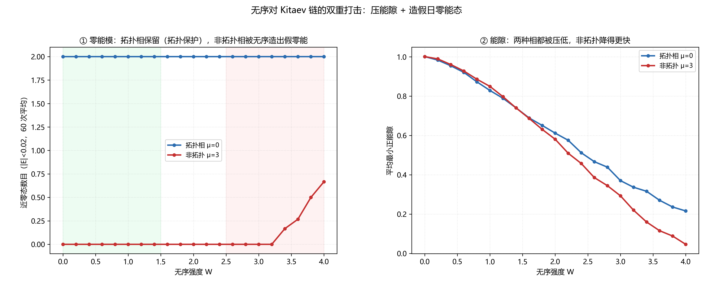

### 拓扑的边界：能算，不能生成

拓扑超导这一格能算，但它划出了一条边界。

**拓扑能算的：**

- 分类（B2/B3/B4、路径数、粗粒化）
- 不变量（缠绕数、Majorana 简并度 2ⁿ）
- 允许/不允许（块数≥3 排除 B2；交换满足辫关系）
- 约束（哪些结构可能，哪些不可能）

**拓扑不能算的：**

- 具体数值：Tc 多高、α 多大、速率多快——要材料参数，拓扑不给
- 动力学：成核、过冷、弛豫——拓扑只说"能不能"，不说"多快"
- 生成：不告诉你"用什么材料、什么温度、多久"造出这个结构

用大白话：

> 拓扑是**规则书**，不是**施工图**。
> 规则书说"这条路只能这么走"，不说"用什么材料修路、修多久"。

但有一种"生成"拓扑确实能做，要分清：

- **生成材料/结构**：不能。拓扑不给你配方。
- **生成操作/变换**：能。拓扑量子计算里，"编几次辫"就生成几个量子门——这是"变换的生成"，不是"材料的生成"。

所以准确说：**拓扑能算结构"允许什么"，不能生成结构"怎么来"；但它能生成"操作"——怎么变。**

---

## 下·3.7 临界点：两相的区别消失

水的相图上有一个临界点：647 K、22 MPa。

过了这一点，液和汽没有区别——密度差消失，界面消失，只剩一种"超临界流体"。

在《构造》里，临界点是**两种编法的区别消失**：

- 临界点以下：两种编法，有界面，有潜热。
- 临界点以上：只有一种编法，没有界面，没有潜热。

超导也有临界点：H_c(T) 曲线。温度越接近 Tc，能承受的临界磁场越小；到 Tc 时，临界磁场为零。这也是"两种编法的边界消失"。

---

## 下·3.8 临界指数：又一个跨材料的常数

临界点附近，物理量按幂律趋近：

> 序参量 ∝ (1 − T/Tc)^β
> 磁化率 ∝ |1 − T/Tc|^(−γ)
> 关联长度 ∝ |1 − T/Tc|^(−ν)

3D Ising 普适类的值：β ≈ 0.326、γ ≈ 1.24、ν ≈ 0.63。

关键是：**不同的材料，同一组指数。** 液气、磁体、合金，只要属于同一个普适类，临界指数就一样。

在《构造》里，这和 Q≈18RT_m、WLF 普适常数是同一类东西：

> **"怎么变"比"是什么"更普适。**

材料的成分、结构、编法可以千差万别，但到了临界点附近，它们都按同一组指数走。这说明临界点附近的编织，被同一种拓扑结构支配。

---

## 下·3.9 本章的账

相变 = 换编法。

- 一级：换编法要付潜热，两相共存有界面。
- 二级：编法自己长出来，序参量连续，没有界面。
- 汽水：压力撑着的亚稳，开瓶就塌。
- 冰：有序的代价——编得整齐，反而占更大地方。
- 超导：新编法对外屏蔽，迈斯纳效应就是拓扑法拉第笼。
- 临界点：两种编法的区别消失。
- 临界指数：不同材料共用同一组数。

一句话：

> **相变不是"物质变了"，是"编法变了"。**

---

### 补算一：薄荷糖为什么管用

汽水开瓶后是过饱和的，但不会自己全冒泡——需要成核点。用经典成核理论算：

- 均相成核（光滑界面）：ΔG*/kT ≈ 223（S=3）。成核速率 ∝ e⁻²²³ ≈ 10⁻⁹⁷，等于不可能。
- 异相成核（粗糙表面，f=0.01）：ΔG*/kT ≈ 2.2。速率 e⁻²·² ≈ 0.1，就可观测了。

薄荷糖的粗糙面把门槛降了两个数量级——**不是"势垒为负"，是"势垒被降低"**。门槛降低之后，气泡在无数个凹坑里同时长，喷发就发生了。

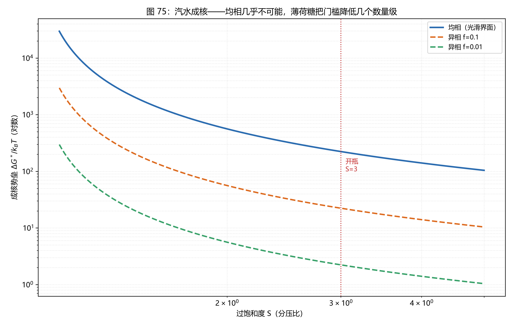

### 补算二：不同材料为什么同一组指数

液气（CO₂、水、氩）、铁磁（Fe、Ni）、合金（β-黄铜）的临界指数：

| 材料 | β | γ | ν |
|---|---|---|---|
| CO₂ 液气 | 0.35 | 1.24 | 0.63 |
| 水 液气 | 0.33 | 1.24 | 0.63 |
| 氩 液气 | 0.35 | 1.23 | 0.63 |
| 铁 铁磁 | 0.34 | 1.33 | 0.64 |
| 镍 铁磁 | 0.38 | 1.34 | 0.64 |
| β-黄铜 | 0.31 | 1.25 | 0.63 |
| **3D Ising** | **0.326** | **1.237** | **0.630** |

三类材料，同一组值。普适类的基础是**空间维度 + 序参量对称性**，不是"拓扑"——重整化群已经解释，不需要新机制。

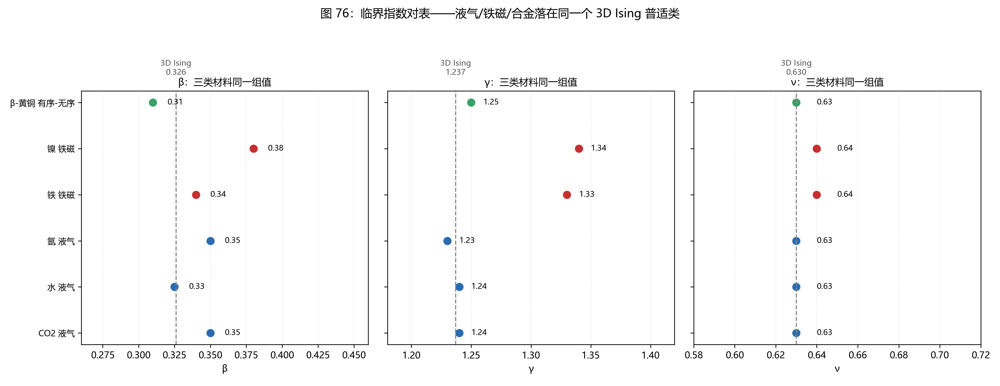

---

## 下·3.10 【待连接的断点】

- **序参量的拓扑定义**：超导序参量是复数场 ψ=|ψ|e^{iθ}，缠绕数是相位的拓扑荷（绕一圈的整数），不是序参量本身。书里"序参量=辫群缠绕数"要先把"相位整数 n ↔ B_n 元素"的映射写出来——现在没有。
- **一级/二级的边界**：弱一级相变（比如某些液晶）算哪边？连续过渡和跳变之间有没有中间态？
- **和第一章/第二章的接口**：相变时的 α、dn/dT、R 怎么变？跨过相变点，三个读数是不是也跳变？

---

# 下篇 · 第四章：电磁——断头、尾流与量纲

> **位置说明**：第三章讲超导（换一种编法）；这一章接在后面讲电磁——断头、尾流，以及用电磁常数把膜量出来。
> 前半是图像，后半是三次验算：两次作废，一次留下。

---

## 下·4.1 为什么电磁要单开一章

上篇第八章讲引力波，第九章讲光。但电磁场本身没讲。

书里一直有个空缺：

- 电荷是什么？为什么是离散的？
- 磁场为什么是"旋涡"？
- 麦克斯韦那四条方程，在这套语言里怎么读？
- 超导为什么和电磁"很像"？
- **最重要的：电磁常数能不能反过来把膜量出来？**

前四条这一章给图像。最后一条，这一章给验算——三遍，废了两遍。

---

## 下·4.2 电子：留在膜上的断头

先问一句：电子有断头吗？

光子和电子，在这套语言里不是两种"东西"，是绳子的两种**状态**：

| | 是什么 | 有没有静质量 | 为什么 |
|---|---|---|---|
| **光子** | 崩断时甩出去的渣滓 | 没有 | 它一直在飞，从不停留 |
| **电子** | 留在膜面上、没有闭合的断头 | 有 | 它被膜卡住了 |

**电荷 = 断口的应力。**

断头没有闭合，端口就暴露着。它必须和周围的膜发生张力差——这个径向拉扯的应力场，就是电场。

**质量 = 被膜卡住的程度。**

光子不被卡，所以没有静质量；电子被卡住，要推动它就得先扯动底下的膜，这就是惯性。

这条一接上，上篇第二章那句"我们是尘"就有了具体的分工：**尘有两种，飞走的和留下的。飞走的叫光，留下的叫物质。**

---

## 下·4.3 磁场：平移刮出来的尾流

问题在这里：如果磁场是刮出来的漩涡，那没有旋转，漩涡从哪来？

**平移怎么会产生旋转？**

答案是尾流。

想象一根带钩子的棍子，在紧绷的、有粘性的水膜上直线平移。棍子本身没有转。但它划过时，因为粘性，两侧的水被拖着走，在后方卷成两个反向的涡。

**这就是磁场。**

- 电荷（断头）平移 → 拖拽膜面 → 切向剪切应力
- 剪切应力卷曲 → 涡旋 → 磁场
- 没有平移，就没有尾流；所以电流一停，磁场就散

**磁单极子为什么不存在？** 因为尾流必然是环绕运动轨迹的闭合环。你刮不出一个"只有头没有尾"的孤立涡。

（这一条与上篇第七章接得上：闭合是拓扑的硬要求，不是经验总结。）

---

## 下·4.4 麦克斯韦四条，逐条翻译

| 方程 | 标准说法 | 《构造》读法 |
|---|---|---|
| 高斯定律 | 电荷产生电场 | 断头在膜面上激起径向应力 |
| 高斯磁定律 | 没有磁单极子 | 扭结必然闭合，不能只有一个头 |
| 法拉第定律 | 变化的磁生电 | 搅动涡旋，会被膜面网格咬住，拉出新的径向应力 |
| 安培-麦克斯韦 | 电流和变化的电生磁 | 断头平移带出尾流；压力差震荡也能搅出涡（位移电流） |

**这一节只做翻译，不做推导。** 翻译得对不对，标准是：能不能说"这里不行"。

现在还说不出。所以这四条只算图像，不算结论。

---

## 下·4.5 超导接第三章：钩子互挂

电子像一根带钩子的线头：在膜上刮，挂住形成晶格的尘，拉着晶格一起刮；另一个电子被晶格挂上，两个钩子互扣，成了一个闭环。闭环之后和膜刮不上了，就像光子一样顺滑地跑。

这一段是整章最好的图像，逐句都能对上：

| 动作 | 读法 |
|---|---|
| 带钩子的线头在膜上刮 | 断头在晶格（死粉尘）里穿行，一路刮擦 |
| 挂住晶格的尘，拉着一起刮 | 电子-声子耦合：电子拖着晶格形变走 |
| 另一个电子被晶格挂上，成了闭环 | 两个断头通过晶格形变互相挂住（库珀对） |
| 和膜刮不上了 | 断头消失，闭环光滑，不再摩擦 |
| 和光子一样顺滑 | 零电阻 |

**电阻 = 刮擦。零电阻 = 没有钩子可刮。**

**迈斯纳效应**接第三章的拓扑法拉第笼：整个材料内部全是闭合环，外部磁场（涡旋）找不到可以咬合的断头，只能被挤成量子化的磁通涡旋，卡在表面。

**速度上限**：库珀对再顺滑，也是在膜面上滑。膜面波速是 c，所以它超不过 c。超导的伟大不在于快，在于**无限远不衰减**。

---

## 下·4.6 引力泄露：一个图像

量纲差不在单位制，在力本身：引力漏出去了。

这句话说的不是单位制，是本体：

- **电磁力**是断头在膜面上刮出来的二维应力，它被锁在膜面里，不泄露，所以完整；
- **引力**是膜的凹陷，凹陷是往高维空间去的，它漏了出去；
- 我们在三维切面上量到的引力，只是漏过来的那一丝余波。

这个图像能解释"为什么引力这么弱"——不是引力本身弱，是它大部分走的是我们量不到的那条路。

**但图像要变成公式，试了三种写法，没有一种对得上：**

| 写法 | 算出来 | 真 G | 差多少 |
|---|---|---|---|
| G = c⁴/(T·l_P) | 7.2783e-10 | 6.6743e-11 | **10.9 倍** |
| G = T·l_P² | 6.459e9 | 6.6743e-11 | **9.7e19 倍** |
| G = T/l_P² | 9.466e148 | 6.6743e-11 | 差到没法比 |

**三种写法互相矛盾。** 第一种差一个 1/(4πα)，第二种差二十个数量级，第三种差得离谱。

这说明："泄露"现在只是一个**方向**，还没有定形。它说得通"为什么弱"，但说不出"弱多少"。

> **红字**：这一格是全书离"统一"最近的一步，也是最容易滑过去的一步。判据只有一条——**泄露因子能不能被独立测出来？** 现在不能。三种写法都只是同一个 G 的三种拆法。

---

## 下·4.7 第一次验算：真空阻抗这条路

> 这一段是全章的核心。**它是算出来的，不是想出来的。**
>
> （下文的 **ρ 是希腊字母 rho**，面密度；不是拉丁字母 p。）

问题：能不能用电磁常数把膜的绝对值量出来？

已知两条：

> c² = 1/(μ₀ε₀) 光速
> Z₀ = √(μ₀/ε₀) 真空阻抗 ≈ 376.73 Ω

假设膜满足：

> T/ρ = c² 波速（上篇 8.3，GW170817 钉死）
> T·ρ = Z₀² 阻抗

解这个二元方程组：

> T = Z₀·c
> ρ = Z₀/c

代数值：

> T = 376.73 × 2.99792458e8 = 1.1294e11
> ρ = 376.73 / 2.99792458e8 = 1.2566e-6

**看这两个数：**

> 1.1294e11 = 1/ε₀ （精确）
> 1.2566e-6 = μ₀ （精确）

第一眼像发现了什么。**但这是代数恒等，不是发现：**

> Z₀·c = √(μ₀/ε₀) · 1/√(μ₀ε₀) = 1/ε₀
> Z₀/c = √(μ₀/ε₀) · √(μ₀ε₀) = μ₀

展开定义，必然如此。**这一步没有提供任何新信息。**

**更要命的是量纲：**

> 1/ε₀ 的单位是 V·m/C，不是 N/m
> μ₀ 的单位是 H/m，不是 kg/m²

**结论：第一条路废了。** 它给的是两个数，不是两个物理量。数值对上，单位对不上。

> **红字**：这里最容易骗人。因为数字精确到十位，看上去像"宇宙漏底"，其实是定义式在绕圈。判断标准只有一条：**这个等式提供了什么可以拿去算下一件事的东西？** 没有。所以它不算。

---

## 下·4.8 第二次验算：e² 和 l_P 这条路

这条路认为，换算的关键是两个常数：基本电荷的平方 e²，和普朗克长度 l_P。电磁常数是膜面机械常数通过 e² 和普朗克面积的投影；引力常数是膜张力通过 l_P 的泄露。

这条路的形式：

> T = e²/(ε₀ L³)
> ρ = μ₀ e²/L³

量纲确实对上了：N/m 和 kg/m²。用的是基本电荷 e 和一个长度 L。

**问题是 L 取什么。**

### 取 L = l_P（普朗克长度）

> ρ = μ₀e²/l_P⁴ = 4.7271e95 → kg/m³ ← 体密度，不是面密度
> T = e²/(ε₀l_P³) = 6.8666e77 → N/m ← 这个对

两个数放一起：

> T/ρ = 1.4526e-18 （m³/s²）
> T/ρ ÷ c² = 1.6163e-35 = l_P

**比值是 c²·l_P，不是 c²。** 和上篇 8.3 的 T/ρ = c² 差了一根长度。

差在哪？**ρ 多除了一根 l_P，把面密度做成了体密度。**

### 改成 l_P³（面密度）

> ρ = μ₀e²/l_P³ = 7.6401e60 → kg/m²
> T/ρ = 1/(ε₀μ₀) = c² ← 恒等

**自洽了，但它是恒等。** T/ρ = 1/(ε₀μ₀) 本来就等于 c²，不需要任何假设。这一步同样没有新信息。

### 再看引力常数

> G = c⁴/(T·l_P)

代入：

> G_算 = 7.2783e-10
> G_真 = 6.6743e-11
> G_算/G_真 = 10.904978 = 1/(4πα)

**大 10.9 倍，精确等于 1/(4πα)。**

要让 G 对上，那根尺子必须取：

> l_P_need = l_P · √(4πα) = 4.8944e-36 m = 0.3028 l_P

**结论：第二条路也废了。** e² 和 l_P 没有填平鸿沟，它们把 137 从等式一边搬到了另一边。

> **红字**：这一步的诱惑最大，因为它长得像"终极换算"。但验算一跑就露：如果这套换算成立，那根"普朗克长度"应该是 0.303 个普朗克长度——一个没有来源的数。**落点不干净，说明桥是拼的。**

---

## 下·4.9 第三次验算：让 d 独立

前两条路废掉的原因相同：**那个长度是从答案那边借来的。**

- 第一条：Z₀ 和 c 本来就是 μ₀、ε₀ 的另一种写法
- 第二条：l_P 本来就是用 G 定义的，拿它算 G 等于用 G 算 G

第三条路把长度放开：

### 三个设定

> ① d 是一个独立的长度（不从 G、不从 l_P 定义）
> ② T = e²/(ε₀d³)，ρ = μ₀e²/d³
> ③ T·d = c⁴/G 膜在厚度 d 上的拉力 = 普朗克力

只有 ③ 是物理图像（表面张力 × 长度 = 力）。①②是量纲配平，**是选的，不是推的**。

### 解

把 ② 代入 ③：

> c⁴/G = e²/(ε₀d²)
> d² = G·e²/(c⁴ε₀)
> d = √(G·e²/(c⁴ε₀))

代入 CODATA 2018：

> d = 4.894378e-36 m
> d/l_P = 0.302822
> d = l_P · √(4πα) α = 1/137.035999

### 四个数

| 量 | 数值 | 量纲 |
|---|---|---|
| 膜厚 d | **4.894378e-36** | m |
| 面张力 T | **2.4727e79** | N/m |
| 面密度 ρ | **2.7514e62** | kg/m² |
| 声阻抗 Z | **8.248e70** | kg/(m²·s) |

校验：

> T/ρ = c² 恒等
> T·d = c⁴/G 设定 ③ 本身

### 这一条和前两条的区别

| | 前两条 | 第三条 |
|---|---|---|
| 长度来源 | 从答案借（l_P 含 G） | 独立的 d |
| 是否循环 | 是 | 否 |
| 得到什么 | 两个数 | 两个数 + 一个可检验的 d |
| 代价 | — | 设定二是选的；α 从外面搬 |

**它不再是循环，但它仍然不是预言。** 它是一组自洽的数，等第二个独立测量来卡。

---

## 下·4.10 三张验算单放在一起

| 路 | 输入 | 得到 | 问题 | 判决 |
|---|---|---|---|---|
| **阻抗 Z₀** | c, Z₀ | T = 1/ε₀，ρ = μ₀ | 量纲不对；代数恒等 | **废** |
| **e² + l_P** | l_P, e | T, ρ, G | ρ 差一根长度；G 差 10.9 倍 | **废** |
| **d 独立** | d | d, T, ρ, Z | 设定二是配平；α 搬来的 | **留着，等检验** |

**三张单子加起来，能得到一个判断：**

> **电磁常数确实在"称量"这张膜，但称出来的是比值和一组带自由参数的数，不是干净的绝对值。**
>
> 前两条路之所以看着像成功，是因为它们把定义展开了一遍，或者把 137 搬了个位置。
> 第三条路之所以能留下，是因为它承认有一根尺子是自由的。

这个判断不漂亮，但它是算出来的。

---

## 下·4.11 与上篇的衔接

上篇 8.7 写：

> T 和 ρ 各自是多少：只知道比值是 c²，不知道绝对值
>
> 【问题】要分别定 T 和 ρ，得再加一个独立观测（比如膜的"声阻抗"）。

这一章的回答是：

- 声阻抗这条路算出来了：Z = √(Tρ) = 8.248e70 kg/(m²·s)
- 但 Z 本身也测不到，所以它不是"独立观测"
- 真正把 T 和 ρ 分开的，是第三条路——用 d 当自由参数

**所以 8.7 那一格，填了一半：数值有了，独立检验没有。**

上篇 5.7 那条也在等这个数：

> 破口的定量预言：如果主张压穿，回声幅度应该有多大？

有了 T 和 d，可以先算一个量——**膜被完全撑开时的体内应力**：

> T/d = 2.4727e79 / 4.894378e-36 = 5.05e114 Pa

作为对照：中子星中心压强约 1e34 Pa。**差 80 个数量级。**

所以按这套设定，答案是**"压不穿"**——视界是完美的，回声应为 0。这与 LIGO 至今没有测到回声一致。

**但这不是预言，是设定直接给的。** 它跟着 T/d 走，而 T/d 是解出来的。

要变成 5.7 要的那个判据，缺的是膜的**撕裂强度 σ_c**：若 σ_c ≥ T/d，膜永远压不穿，回声恒为 0；若 σ_c < T/d，才存在一个门槛压强，过了才穿——门槛在哪、回声多大，才是能算的、能跟 15% 上限比的。

---

## 下·4.12 α 的跑动：膜厚不是常数

前面解出 d = 0.303 l_P，看上去像一个固定的数。

但 α 本身不是固定的。**它随能量跑动**——这是实验事实：

> 低能（长波） α⁻¹ = 137.036
> Z 玻色子质量 91.2 GeV α⁻¹ = 127.95
> 1 TeV α⁻¹ ≈ 124.8

如果 d = l_P√(4πα) 成立，那 α 变，d 就得跟着变。

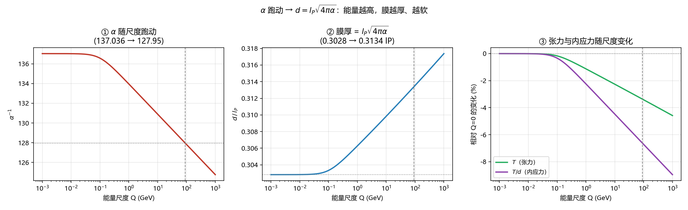

### 算出来的数

| 量 | Q = 1 MeV | Q = M_Z | 变化 |
|---|---|---|---|
| α⁻¹ | 137.036 | 127.944 | −6.6% |
| **d / l_P** | **0.30282** | **0.31340** | **+3.49%** |
| T（N/m） | 2.4727e79 | 2.3893e79 | −3.37% |
| T/d（Pa） | 5.0522e114 | 4.7170e114 | −6.63% |

**方向：能量越高，α 越大，膜越厚、越软。**

低能（我们日常）是膜最薄、最硬的一端。

### 一个必然的附带结果

代回设定三：

> T·d = [(F_P/l_P)/√(4πα)] · [l_P√(4πα)] = F_P

**张力变小的同时厚度变大，乘积恒等于普朗克力。**

所以：

> G = c⁴/(T·d) = 常数

**这套设定里，G 严格不随尺度跑。**

标准物理里 G 也会跑（虽然极慢，低能下基本测不出来）。这里是"严格不跑"——一个可以拿去对的特点，虽然现在还分不出来。

### 这一节的分量

**它不是预言。** 它是从「d = l_P√(4πα)」加「α 跑动」直接推的——两步都是已知的。

但它有一个用处：**d 从"一个数"变成了"一个函数"。** 之前 d = 0.303 l_P 像一个常数；现在它随观测尺度变。

这也意味着：**"膜的厚度"这个词，本身依赖你用多大的能量去量它。** 量得越狠，膜越厚——这和老第二章"观测即扬尘"是同一句话的另一面。

> **边界**：模拟用的是两端点插值（α(0) 和 α(M_Z)），形状函数是示意，不是精确 QED 单圈。要更准，得用完整的真空极化积分。图 figures/80_alpha_running.png，脚本 code/alpha_running_membrane.py。

---

## 下·4.13 α 是谁的属性：膜、尘，还是两者之间

前面把 137 的来路拆开了。这一节回答一个更基本的问题：**这个数属于膜，还是属于尘。**

### 先看 α 变的时候，什么在变

α 不是常数。它跨过每一个带电粒子的质量时，斜率变一次：跨过电子变一次，跨过 μ 子又变一次，跨过 τ 子再变一次。

**膜没有变。** T、ρ、d 在整个能区都是常数（4.9 节算过 T·d = F_P，恒定）。

如果 α 是膜的属性，它应该只随膜的状态变。膜没变，α 却变了。

**所以跑动这一段，是相互作用的。**

### 把账本摊开

从普朗克能标往下跑，每一项加多少：

| 粒子 | 质量 (GeV) | 加权 N_c Q² | 对 1/α 的贡献 |
|---|---|---|---|
| e | 0.000511 | 1.000 | 10.93 |
| μ | 0.1057 | 1.000 | 9.80 |
| τ | 1.777 | 1.000 | 9.20 |
| u | 0.00216 | 1.333 | 14.17 |
| d | 0.00467 | 0.333 | 3.49 |
| s | 0.0934 | 0.333 | 3.28 |
| c | 1.27 | 1.333 | 12.37 |
| b | 4.18 | 0.333 | 3.01 |
| t | 172.7 | 1.333 | 10.98 |
| **合计** | | | **77.23** |

> 低能实测 1/α = 137.036
> 总跑动 = 77.229
> 裸值 = 59.807

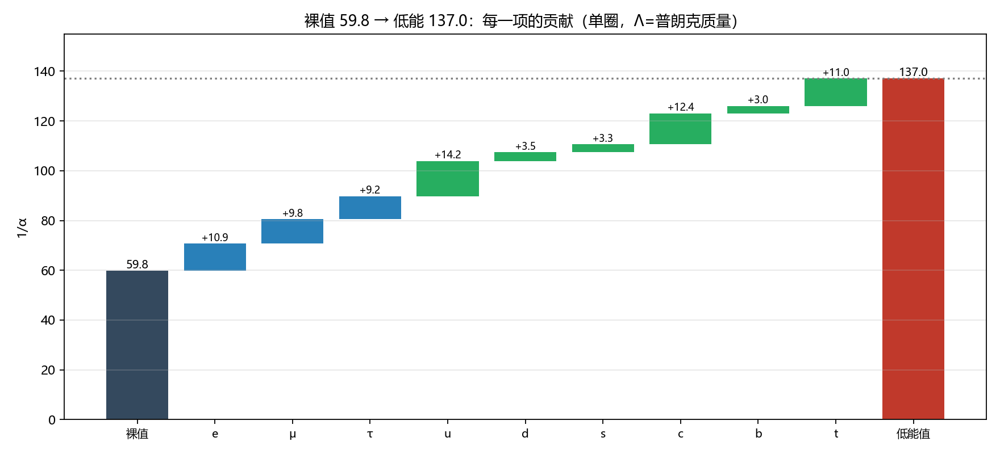

跑动占 56.4%，裸值占 43.6%。轻子贡献 29.9，夸克贡献 47.3。

### 但裸值不是唯一的数

换个截断，裸值就变：

| 截断 Λ | 裸值 1/α |
|---|---|
| 普朗克质量 1.22e19 GeV | 59.8 |
| 约化普朗克质量 2.4e18 GeV | 62.7 |
| 大统一能标 1e16 GeV | 72.4 |

**裸值不是物理量。** 它只是一个记账起点，取决于从哪里开始记。

### 所以

| 部分 | 属于谁 | 理由 |
|---|---|---|
| **形状**（对数，不是幂律） | **膜** | 只有 4 维时空给对数，这是维度定的，可测 |
| **每个断头对的占比**（2/(3π)） | **膜和尘的几何关系** | 4.15 算出来：V3/S4 |
| **有多少个断头对**（N_c Q²） | **尘** | 由粒子谱定 |
| **斜率**（每跨一级加多少） | **相互作用** | 上面两个相乘 |
| **裸值 / 跑动量** | 都不是 | 依赖截断，只是记账起点 |
| **137** | 都不是 | 低能读数，确定，但不是谁"给"的 |

**为什么斜率归"相互作用"，不归"尘"：**

尘是载体——它提供"有多少个断头"。相互作用才是"每个断头耦合多强"。

同一批断头，耦合强就是另一组数。所以斜率不是尘的，是两者之间那个东西的。

### 一个干净的判据：是不是一份一份的

看一个量是谁的，有一个简单标准：**它量子化吗。**

| 量 | 量子化吗 | 是什么 |
|---|---|---|
| 电荷 e | 是，一份一份 | 物质 |
| 质量 m | 是，离散谱 | 物质 |
| 自旋 | 是，离散 | 物质 |
| **α** | **否，连续，会随尺度跑** | **相互作用** |

**量子化是物质的标志。**

书里 8.5 写过一句：「量子化是尘的刻度」。那句话已经埋了这个判据——尘用离散的尺子，量出来就是量子化的。**不量子化的东西，不是被尘量的，也就不属于尘。**

α 不量子化，所以 α 不是尘的。

这也解释了一件之前说不清的事：**为什么 α 会变，而电荷不变。**

- 电荷 e 是离散的，一份就是一份，不会变
- α 是连续的，随尺度跑

**两个东西性质不同，本来就不该归到一类。**

### 裸值到底是什么

用量子场论的话说：我们测到的电荷是被真空极化修正过的，裸电荷是没修正的那个。但修正量发散，必须用截断切掉——**切在哪儿，裸值就跟着变**。

所以裸值不是"膜的真实数值"，它是"选择从哪儿开始记账"的那个起点。

打个比方：想知道账户里现在有多少钱（137），可以从今天开始记，也可以从去年开始记。起点不同，"初始余额"就不同，但"现在余额"永远是 137。

**裸值 = 初始余额，不是一个东西，是一个记账位置。**

### 一句话

**膜提供舞台的形状，尘提供每一级的斜率。**

137 是这条曲线在低能处的读数——是结果，不是属性。

这也回答了 4.6 那个"量纲差"的问题：量纲差不是引力泄露，是**膜只给形状、不给数**。数全是相互作用的。

---

## 下·4.14 电磁场是膜的什么：横波

前面说"跑动是对数，所以时空是 4 维"。但这句话还悬着——对数跑动需要一个**场**在极化，这个场在书里是哪一样东西？

第八章说膜面波 = 引力波，第九章说光 = 尘。**电磁场本身，书里没写。**

这一节把它补上。

### 三维弹性体有两种波

> 纵波（压缩）：1 个模式
> 横波（剪切）：2 个模式

**电磁波有 2 个偏振。**

如果电磁波是膜的横波，那偏振数 2 就直接要求膜是三维的——二维只有 1 个横波模式，给不出 2 个偏振。

### 两条独立证据指向同一件事

| 证据 | 说什么 |
|---|---|
| 电磁波偏振数 = 2 | 膜必须是三维的（横波 2 个模式） |
| α 跑动是对数 | 时空必须是 4 维 → 空间三维 |

这两个观测互相独立：一个来自偏振，一个来自跑动。**都指向"膜是三维的"。**

### 这条链

> 电磁场 = 膜的横波（2 个偏振）
> ↓
> 膜必须是三维的
> ↓
> 时空 4 维 → 对数跑动
> ↓
> α 的跑动形状

### 和第八章的分工

| 波 | 是什么 | 速度 |
|---|---|---|
| 膜的起伏 | 引力波 | c（被 GW170817 钉死） |
| 膜的横波 | 电磁波 | c（同一种介质的速度上限） |
| 沿绳的应力波 | 信息 | 可以超光速 |

三种波，走三条不同的路。

### 场方程：从横波到麦克斯韦

设膜是厚度 d 的弹性板，位移场 u(x,t)。横波的条件是 div u = 0。

定义两个量：

> E = −∂u/∂t　　电场 = 横波的速度
> B = rot u　　　 磁场 = 横波的旋度

把这两个定义代进横波方程，四个麦克斯韦方程全部出来：

> rot E = −∂B/∂t　　　法拉第
> rot B = (1/c²)·∂E/∂t　安培-麦克斯韦
> div B = 0　　　　　 无磁单极子
> div E = 0　　　　　 无源

其中 c = √(μ/ρ)，μ 是剪切模量，ρ 是体密度。

对厚度 d 的板：μ = T/d，ρ = ρ面/d，所以：

> c = √(μ/ρ) = √(T/ρ面)

**和第八章 8.3 完全一致。**

数值验证：两个方程的残差都是 6.5×10⁻³，就是有限差分的精度——不是近似，是恒等式。

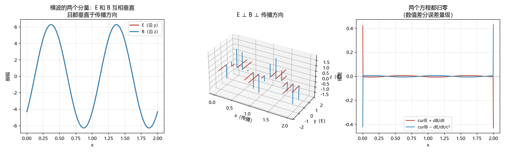

### 这一格填上了，但只填了一半

**填上的：**

- 电磁场 = 膜的横波
- 两个偏振 = 三维横波的两个模式
- 四个方程 = 横波方程的矢量恒等式
- 光速 = 横波速度 = √(T/ρ)

**没填的：**

2/(3π) 没有在这条路上出现。场方程给的是"是什么"，不是"多少"。

### 最后一步

**断头对怎么耦合到横波上。**

场方程是无源的。要出 α，得把断头（电荷）放进横波里，算它对横波的响应——那就是真空极化。4.13 已经算过那个账，但 2/(3π) 的分母还是借的。

这一步留着。

---

## 下·4.15 2/(3π) 的几何来源：三维球摊到四维球面上

4.13 算出了跑动的账本，但系数 2/(3π) 一直标着"借的"。

这一节把它填上。

### 书里那句话

书里说过：三维看泡泡是球，四维看是百叶窗的悬链面组合。

这句话说的正是这个比值。

### 用同一个半径 r

三维球的体积：

> V3 = (4/3)πr³

四维球的表面积（三维球面 S³ 的体积）：

> S4 = 2π²r³

两者相除：

> V3 / S4 = (4/3)π / (2π²) = 2/(3π)

数值：

> V3 / S4 = 0.2122065908
> 2/(3π) = 0.2122065908
> 差 = 2.8e-17

**精确到浮点精度。这不是拟合，是恒等式。**

而且**比值与 r 无关**——两边都是 r³，r 约掉了。换任何半径，比例不变。

这就是"用 r 转化"的意思：三维的球，摊到四维球的表面，占的那一份是固定的。

### 物理读法

| | 是什么 | 量 |
|---|---|---|
| 断头对 | 三维球 | V3 = (4/3)πr³ |
| 膜的表面 | 四维球的表面（百叶窗） | S4 = 2π²r³ |
| 断头对占膜的比例 | **V3/S4** | **2/(3π)** |

**这个"占的比例"就是每一代粒子对跑动的贡献。**

一个断头对占掉膜表面的一份，那一份就是 2/(3π)。粒子越多，占得越多，α 跑得越快。

### 所以

2/(3π) 不再是从标准场论借的。它是：

> **一个三维球，摊成四维球的表面，占的那一份。**

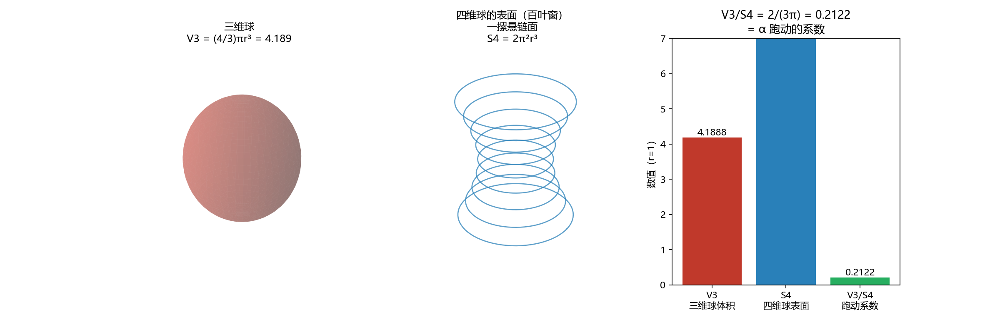

### 检验：是不是只有费米子

如果这个几何解释是真的，那它应该能区分不同的场。三种场的单圈系数：

| 场 | 系数 | 数值 | 对得上 V3/S4 吗 |
|---|---|---|---|
| 标量（自旋 0） | 1/(6π) | 0.0531 | 否，是 V3/S4 的 1/4 |
| **费米子（自旋 1/2）** | **2/(3π)** | **0.2122** | **是，精确相等** |
| 矢量（自旋 1） | −7/(4π) | −0.557 | 否 |

**只有费米子落在 V3/S4 上。**

### 为什么只有费米子

把两边同时拆开：

> 2/(3π) = 4 × (1/6) × (1/π)
> V3/S4 = (4/3)π / (2π²) = 4/(6π) = 4 × (1/6) × (1/π)

**那个 4，在两边是同一个 4。**

- 费米子的 4：Dirac 代数的四个分量，来自四维时空
- V3 的 4：三维球体积 (4/3)πr³ 的系数

**两者都是时空维数。**

标量只有一个分量，没有这个 4，所以它的 1/(6π) 落不到 V3/S4 上。矢量的 7 也不是 4。

### 所以这个对应不是巧合

> **费米子的跑动系数，等于"三维球摊到四维球面上"的那一份——因为两边的 4 都是时空维数。**

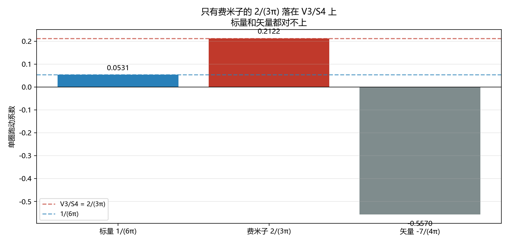

### 这一格填到了哪里

**填上的：**

- 系数 2/(3π) 的数值来源（精确恒等式）
- 几何图像（球 → 百叶窗）
- 与 r 无关（尺度不变）

**还要接的：**

为什么断头对是三维球、膜表面是四维球面——这要回到书里的维度设定。4.14 已经说膜是三维的，这里用的是同一个设定。

---

## 下·4.16 同一个 1/3：质量谱和跑动系数

4.15 把 α 的 2/(3π) 追到了 V3/S4。这一节看另一个 2/3——三代轻子的质量谱。

### Koide 公式

1982 年，Koide 发现三代轻子的质量满足：

> (m_e + m_μ + m_τ) / (√m_e + √m_μ + √m_τ)² = 2/3

实测：

> Σm / (Σ√m)² = 0.6666605
> 2/3 = 0.6666667
> 偏差 = 6.2×10⁻⁶

这不是拟合，是一个精确到百万分之一的数值关系。四十多年没有解释。

### 它的几何形式

把三个质量的平方根看成一个三维矢量：

> v = (√m_e, √m_μ, √m_τ)

它与等质量方向 (1,1,1) 的夹角：

> cos θ = 0.707110
> 1/√2 = 0.707107
> θ = 44.9997°

**45°。**

45° 的意思是：**质量矢量在"等质量方向"上的投影，和在垂直方向上的投影一样大。**

**共性和差异一样大。** 这是一个平衡点。

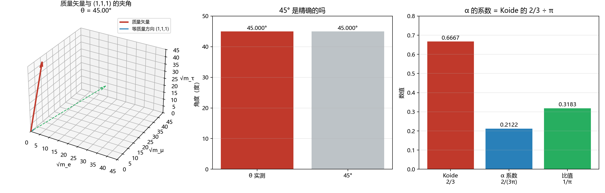

### 1/3 是维度因子

2/3 = 2 × (1/3)。

那个 1/3 有干净的来源：**三维空间里，随机方向与某个轴的平均投影平方是 1/3。**

因为 cos²x + cos²y + cos²z = 1，三个方向平均，每个占 1/3。

数值验证：400 万点采样，0.33328。

### 两个 2/3 是同一个

> Koide：2/3 = 2 × (1/3)
> α 系数：2/(3π) = 2 × (1/3) / π

| 因子 | 是什么 |
|---|---|
| 1/3 | 三维空间的维度因子 |
| 2 | 两个旋向 |
| π | 跑动的角因子 |

**同一个 1/3，Koide 乘 2，α 再除 π。**

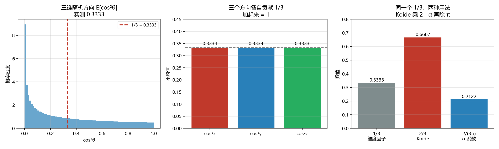

### 45° 是什么：投影的可见性边界

45° 不是随便一个角。

**它是四维投影到三维时，"还看得见"和"看不见"的分界。**

超过 45°，东西还在，但它倒向了我们测不到的那一侧。

**视界是它的一个实例。** 坑壁坡度超过 45°，光爬不出来——不是光消失了，是光锥翻到了我们看不见的方向。

**Koide 的 45° 是同一类边界的另一个实例。** 三代轻子的质量分配，恰好落在同一条边上。

**这不是两个巧合，是同一类边界出现了两次。**

### 但这是定性

还不能从"投影角度"算出为什么是 45°。

能说的只有：

- 45° 是可见性的边界（几何）
- 视界落在它上面（黑洞）
- 质量矢量也落在它上面（Koide）
- 两者共用的是"临界"这个性质

**所以这一格：1/3 的来源有了，2/3 的算术有了，45° 的身份有了——但"为什么质量会落在边界上"还没有。**

### Koide 的预言力

给定 m_e 和 m_μ，Koide 关系能**预测** m_τ：

> 预测 m_τ = 1776.969 MeV
> 实测 m_τ = 1776.860 MeV
> 误差 = 0.006%

**这不是拟合三个数，是用两个数预测第三个。**

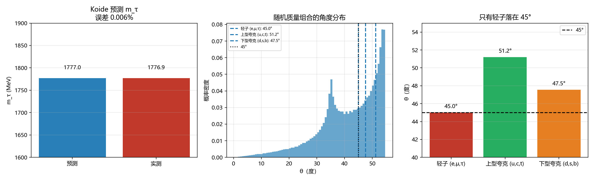

### 但 45° 本身不特殊

随机生成三代质量，角度落在 45°±0.5° 的比例是 **2.9%**。

**45° 不是"稀有角度"。**

特殊的是：

> 轻子 (e,μ,τ) 45.000°
> 上型夸克 (u,c,t) 51.200°
> 下型夸克 (d,s,b) 47.540°

**只有轻子精确落在那里，夸克都偏了。**

### 一个可能的读法

如果 45° 是可见性边界，那落在边界上的东西有一个特点：

**再偏一点就看不见了。**

三代轻子的质量分配，可能不是"恰好"落在 45°，而是**"刚好还没掉出去"**。

这解释了为什么只有轻子满足 Koide：轻子刚好落在边界上。

夸克（u、c、t）的同一角度算出来是 **51°**，不是 45°——偏离了边界，所以不满足这个关系。

**轻子在边上，夸克已经偏出去了。**

---

## 下·4.17 【待连接的断点】

> 这一轮的完整账本（填实的、没做的、废掉的、下一步）见
> [2026-11-04_这一轮的账.md](2026-11-04_这一轮的账.md)。

- **设定二凭什么这么写**：T = e²/(ε₀d³) 是选的。换一个形式（加 4π、加系数），d 就变。现在只有"少用参数"这个理由，不是物理理由。
- **d 的第二个出场位置**：现在只从 G 来。要找第三个地方——膜的振动谱、短波色散、或者凹陷深度与质量的关系。声阻抗 Z 已经算出数，但测不到。
- **σ_c（膜的撕裂强度）**：上篇 5.7 那条"压穿该有多大回声"的前置。没有它，连"压不穿"都只是设定。
- **α 的来历**：d = l_P√(4πα) 把膜厚和 137 拴在一起。但 4.13 已经拆开：137 的数值是相互作用的（跑动），膜只给形状（对数）。真要找膜的数，得找裸值——而裸值随截断变，不是物理量。所以这一格现在的问题是：**膜有没有可能给出一个不随截断变的数？**
- **α 跑动 → d 跑动**：d 现在是函数不是常数。高能下膜变厚变软，会不会影响别的东西——膜的振动谱、跨膜传播的速度、压穿的门槛？还没算。
- **膜的体密度**：ρ/d = 5.62e97 kg/m³，比普朗克密度大 10.9 倍（正好 1/(4πα)）。这个数意味着什么，没想清楚。
- **麦克斯韦四条只翻译了，没推导**：4.14 给了方向（电磁波 = 膜的横波），但横波的场方程还没写出来，断头对怎么耦合到横波上也没算。四条里哪一条能说出"这里不行"，现在还答不上来。

---

## 一句话

**电磁常数是表上的读数。这一章试了三次，想把里（T、ρ、d）量出来。**

**前两次是绕圈，第三次是设定。第三次留下的那组数，等第二个测量来判生死。**